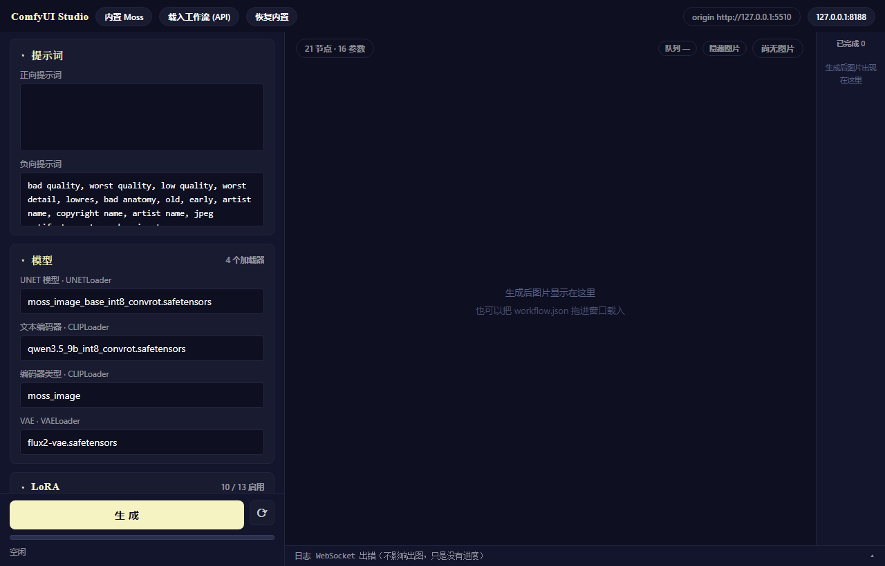

# ComfyUI Studio

把 ComfyUI 工作流变成网页表单的出图台：载入工作流即可生成参数面板，改完点一下出图。

[](LICENSE)
[](https://www.python.org/)
[](#)
[](web/app.html)



> 截图为未连接 ComfyUI 时的状态（右上角队列显示「—」）。连接后下拉框会填入服务端的真实模型列表，队列显示当前任务数。

## 为什么用它

ComfyUI 的工作流是一张节点图，调参数得在画布上找节点、改 widget、再点运行。参数一多，这套操作就变慢，也不适合反复试同一个变量的不同取值。

ComfyUI Studio 把这张图反向解析成一份参数表，渲染成常规网页表单：提示词、模型、LoRA、步数、CFG、采样器、尺寸、种子在左侧成组排列，右侧实时看结果。工作流本身不做任何改动，换一份工作流就换一套面板，不需要写配置文件。

## 特性

- **参数面板自动生成** —— 参数从工作流结构推导，无需手写 `params.json` 之类的映射
- **兼容任意工作流** —— 载入 ComfyUI「导出 (API)」格式的 JSON 即可，多个采样器各自成组
- **单文件前端** —— `web/app.html` 无构建、无依赖、无框架，起个静态服务器就能用
- **实时进度** —— 常驻一条 WebSocket 跟踪执行进度与队列，支持多任务排队、单条中断
- **参数快照** —— 按工作流指纹自动保存，刷新不丢，切换工作流不会串参
- **跨域排查工具** —— 附带 CORS 体检脚本与加固用反向代理
- **后端地址可切换** —— 本地与局域网共用一套界面，页面右上角随时改

## 快速开始

### 环境要求

- Python 3.9+（只用标准库，无需 `pip install`）
- 一个可访问的 ComfyUI 服务（默认 `127.0.0.1:8188`）
- 现代浏览器（Chrome / Edge 等）

### 获取代码

```bash
git clone https://github.com/sxwzzz432/comfyui-studio.git
cd comfyui-studio
```

### 一键启动

双击 `start.bat`，或：

```powershell
.\start.ps1
```

脚本依次完成：查找 Python → 挑一个可用端口（默认 5500，被本项目占用则复用，被其他程序占用则顺延最多 20 个）→ 在仓库根目录起静态服务器 → 探测 ComfyUI 是否可达（不可达只提示、不阻塞）→ 打开浏览器。

```powershell
.\start.ps1 -Port 5600               # 换端口
.\start.ps1 -Comfy 192.168.1.6:8188  # 检查另一个 ComfyUI 地址
.\start.ps1 -NoBrowser               # 只起服务，不开浏览器
.\start.ps1 -Stop                    # 停掉占着端口的 Python 进程（窗口被强杀时用）
```

### 手动启动

静态服务器的根目录必须是**仓库根目录**（页面需要读取 `../workflow/moss.json`）：

```bash
python -m http.server 5500 --bind 127.0.0.1
# 打开 http://127.0.0.1:5500/web/app.html
```

## 使用

### 载入工作流

三种方式等价：

1. 点右上角「载入工作流 (API)」选文件
2. 把 `.json` 直接拖进窗口
3. 命令行 `python tools/workflow_engine.py scan -w 你的.json` 先预览推导结果

工作流必须是 **API 格式**（ComfyUI 里用「导出 (API)」而非「导出」）。若载入的是含 `nodes` / `links` 的 UI 格式，页面会明确提示重新导出，不会静默失败。

### 参数面板

左栏按类别分组：提示词、模型、LoRA、采样器、尺寸与批量、输出。所有下拉选项（模型、VAE、采样器、调度器）实时取自 ComfyUI 的 `/object_info`；服务端的模型被删除后，快照里的旧值会自动回退并提示。

### 多采样器

工作流中存在多个 `KSampler` / `KSamplerAdvanced` / `SamplerCustom` 时，左栏会出现多个独立子框，标题取节点自身的 `_meta.title`（例如「K采样器 · #1134」），各自的步数、CFG、采样器、种子互不影响。子框标题右侧显示摘要（`50步 · CFG 4 · euler`），点击可折叠。

### 任务队列

预览区右上角的 `队列 N` 徽标对应 ComfyUI `/queue` 的 `queue_running + queue_pending`，有任务时变黄。展开后可见运行中与排队任务的 `prompt_id`，支持单条中断、删除与整体清空。

「生成」按钮不锁：出图过程中继续点击会再排一个任务，按钮显示 `生成中… (N)`，N 为本地未完成数。每个任务按自己的 `prompt_id` 跟踪，完成后依次追加到右侧列表。

### 参数快照

任何参数改动都会（防抖 500 ms）写入 `localStorage`，键为工作流指纹（FNV-1a 哈希），因此切换工作流不会串参。刷新自动恢复，最多保留最近 8 份，超出自动淘汰。只有点「恢复内置」才会清空快照并回到工作流默认值。

### 完成列表

右侧竖向列表常驻，按 `sessionStorage` 中的引用（文件名、subfolder、type、`prompt_id`、大小）在刷新后重新拉取图片，因此刷新不丢、关掉标签页才清空。图片 blob 只存在于内存，切走即 `revokeObjectURL`。

缩略图右下角的 `↻` 可套用该图参数：工作流不随图保存，点击时按 `prompt_id` 向 `/history/{id}` 查询。

### 隐藏图片

顶栏的「隐藏图片」会把预览与缩略图一起模糊并覆盖遮罩，用于截图分享时避开画面内容。状态记在 `localStorage`，刷新后保持。

## 工作原理

核心是 `tools/workflow_engine.py` 与 `web/app.html` 中的同一套推导逻辑（前者 Python，后者 JS，行为经测试对齐）。没有手写映射文件，全部从工作流结构推导：

| 目标 | 推导规则 |
|---|---|
| 正向 / 负向提示词 | 从第一个 KSampler 的 `positive` / `negative` 向上游 BFS，按打分挑最像提示词的字符串输入；节点标题、类名、字段名、是否非空都参与打分，LoRA 加载器会被跳过（其 `text` 是一串 `<lora:..>`） |
| 模型 | `unet_name` / `ckpt_name` / `clip_name` / `clip_name1,2,3` / `vae_name`，选项取自 `/object_info` |
| 编码器类型 | `CLIPLoader.type`（换架构时通常需要同步调整） |
| LoRA | 带 `loras` 字段的节点 → 结构化列表编辑器；普通 `LoraLoader` → 名称下拉 + 权重 |
| 采样器 | 每个 `KSampler` / `KSamplerAdvanced` / `SamplerCustom` 各成一组，组内暴露全部标量输入（steps / cfg / denoise / sampler_name / scheduler / seed，以及 `KSamplerAdvanced` 的 `add_noise` / `start_at_step` 等） |
| 种子 | 若 `seed` 是连线（例如接到 rgthree 的 `Seed` 节点），会顺到上游修改真正的节点 |
| 尺寸 | 找带 `width` / `height` 的 latent 节点；若连到 `ResolutionPreset` 这类带 `resolution_json` 的节点，用适配器整体改写；字面量则拆成宽高两个输入 |
| 输出 | `SaveImage.filename_prefix` |

只推导「能确定」的参数：自定义节点里含义不明的输入不会硬猜，避免猜错写错。

换模型或换架构时，在页面下拉里直接选，或修改 `workflow/moss.json` 中对应节点的模型名；采样器、步数、CFG 通常也需要跟着调整。

## LoRA 字段：以 `loras` 为准

`comfyui-lora-manager` 的加载器读取的不是 `text` 字段，而是 `loras`：

```python
def load_loras(self, model, text, **kwargs):
    del text                                         # text 被直接丢弃
    lora_entries = _collect_widget_entries(kwargs)   # 实际读取的是 loras
```

此外，`active` 为 `false` 的条目会被跳过。也就是说，若工作流的 `text` 里写着 13 个 LoRA，实际可能只加载 10 个。

`tools/test_lora_field.py` 在运行中的服务上做过三组对照实验验证这一点：

| 实验 | 配置 | 预期 | 实测 |
|---|---|---|---|
| A | `loras` 填空值 LoRA + `text` 填真 LoRA | 成功 ⇒ text 被忽略 | 成功 |
| B | `loras` 填不存在 + `text` 填真 LoRA | 报错 ⇒ loras 权威 | 报 `No such file or directory` |
| C | `loras` 填不存在但 `active: false` | 成功 ⇒ 该条被跳过 | 成功 |

因此页面上的 LoRA 编辑会同时写入 `loras`（真正生效）与 `text`（保留以便回 ComfyUI 中查看）。

## 命令行

同一套扫描、读值、应用逻辑也可以脱离浏览器使用：

```bash
cd tools
python workflow_engine.py scan                 # 查看内置工作流被推导出的参数
python workflow_engine.py scan -w 我的.json     # 扫描任意工作流
python workflow_engine.py read                 # 打印当前参数值
python workflow_engine.py apply --set 1134.steps=24 --out out.json
python workflow_engine.py run   --set 1160.positive="1girl" --set 1140.resolution_json=768x1024
python workflow_engine.py selftest             # 参数引擎自检
```

## 目录结构

```
start.bat              一键启动入口（双击）
start.ps1              启动脚本本体：找端口 / 起服务 / 开浏览器 / -Stop 收尾
workflow/
  moss.json            内置工作流（API 格式），换模型改这里的节点模型名
web/
  app.html             出图台页面（单文件、零构建、零依赖）
tools/
  workflow_engine.py   核心引擎：工作流 → 参数表、应用参数、CLI
  comfy_smoke.py       冒烟测试：模型清单、出图、打印每一跳的 CORS 头
  cors_doctor.py       跨域体检：识别三种 CORS 形态并判定浏览器是否会拦截
  cors_bridge.py       加固用反向代理：回显 Origin、白名单、PNA、WebSocket 隧道
  web_logic_probe.js   将 app.html 中的纯逻辑抽出供 Node 调用
  browser_smoke.mjs    CDP 驱动 headless Chrome，实测多任务排队 / 进度 / 列表持久化
  browser_snapshot.mjs 参数快照回归：改参 → 刷新恢复 → 恢复内置回默认
  test_web_logic.py    网页 JS 与 Python 引擎的一致性测试
  test_lora_field.py   在运行中的服务上做 LoRA 字段对照实验
  test_cors_bridge.py  桥接层端到端测试
  test_cors_doctor.py  跨域体检工具在三种形态下的判定测试
```

## 配置

### ComfyUI 地址

默认 `http://127.0.0.1:8188`，页面右上角可随时修改，本地与局域网共用一套界面。

### 跨域

浏览器直连 ComfyUI 时，若服务端未放行当前页面来源，请求会被拦。排查顺序：

1. `python tools/cors_doctor.py` —— 判定当前 ComfyUI 属于哪种 CORS 形态、浏览器会不会拦
2. `python tools/comfy_smoke.py` —— 打印每一跳实际返回的 CORS 头
3. 若无法修改 ComfyUI 配置，用 `python tools/cors_bridge.py` 起一层反向代理（回显 Origin、白名单、PNA、WebSocket 隧道）

## 测试

| 项 | 内容 |
|---|---|
| `test_web_logic.py` | 网页 JS 与 `workflow_engine.py` 在扫描、读值、应用三处的一致性（含多采样器工作流） |
| `workflow_engine.py selftest` | 参数引擎自检 36 项 |
| `browser_smoke.mjs` | 端到端：连点 3 次生成 → 排队、进度、出图 3 张、按钮全程不锁、刷新后列表还原 |
| `browser_snapshot.mjs` | 参数快照回归：改参 → 刷新恢复 → 恢复内置回默认 → 再刷新仍为默认 |
| `test_lora_field.py` | LoRA 字段行为的三组对照实验 |
| `test_cors_bridge.py` / `test_cors_doctor.py` | 跨域代理与体检工具的端到端测试 |

## 当前限制

- 完成列表不持久化，关闭标签页即清空；更早的图片请到 ComfyUI 的 `output/` 目录查看
- 页面不校验 LoRA 文件是否存在（命令行 `run` 会校验）
- 只推导含义明确的参数，自定义节点中含义不明的输入不会推测
- 没有用户体系与配额管理

## 后续方向

- 扩大参数推导对自定义节点的覆盖
- 参数预设的导入与导出
- 完成列表的可选持久化

## 许可证

[MIT](LICENSE)
